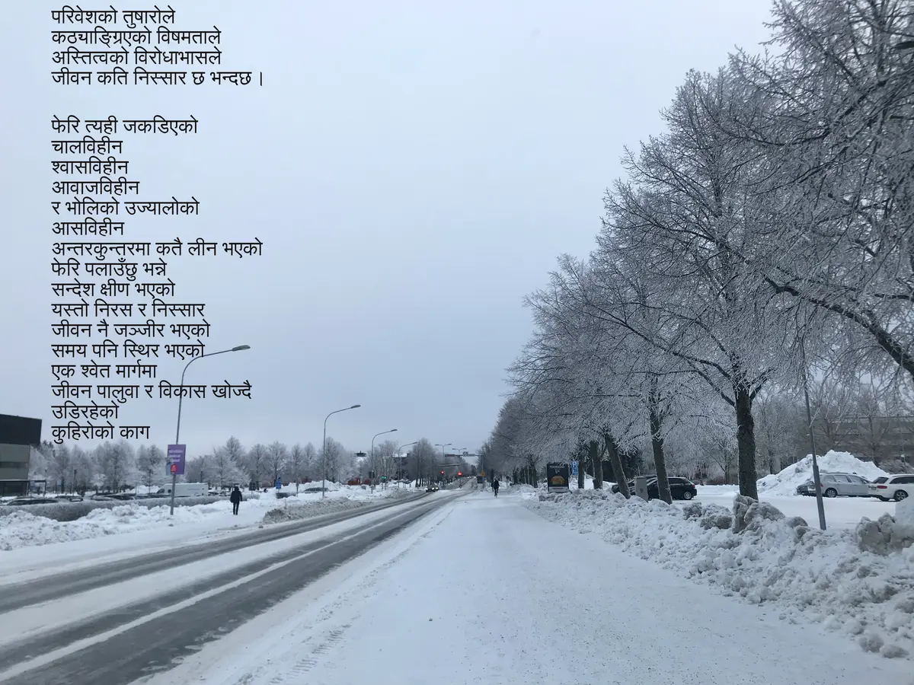

+++
title = "Nepali Poem: कुहिरोको काग (A crow in the fog)"
date = 2026-11-12
summary = "This is the second time I have used the metaphor 'कुहिरोको काग' in my creation. First time, it was used in a blog post titled - 'Contemplation on Mid-life Crisis'"
categories = ["Nepali Poem"]
+++

### कुहिरोको काग

परिवेशको तुषारोले  
कठ्याङ्ग्रिएको विषमताले  
अस्तित्वको विरोधाभासले  
जीवन कति निस्सार छ भन्दछ।

फेरि त्यही जकडिएको  
चालविहीन  
श्वासविहीन  
आवाजविहीन  
र भोलिको उज्यालोको  
आसविहीन  
अन्तरकुन्तरमा कतै लीन भएको  
फेरि पलाउँछु भन्ने  
सन्देश क्षीण भएको  
यस्तो निरस र निस्सार  
जीवन नै जञ्जीर भएको  
समय पनि स्थिर भएको  
एक श्वेत मार्गमा  
जीवन पालुवा र विकास खोज्दै  
उडिरहेको  
कुहिरोको काग

<figure>

 <figcaption>Kuhiroko Kaag - A Nepali Poem by Dipesh Dulal</figcaption>
 </figure>